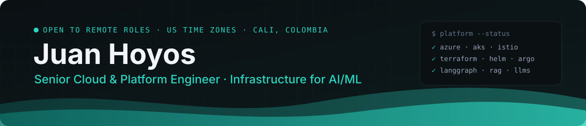

  
  
  

---

### 👋 About me

I'm a **Senior Cloud / Platform Engineer (SRE)** with **4+ years** designing and operating the enterprise Azure and Kubernetes platform behind **GM Financial's** customer-facing products: payments, authentication, account creation and vehicle financing.

I like building the paved road: internal developer platforms, reusable infrastructure and deployment pipelines that let product teams ship safely without thinking about the plumbing. In parallel I'm finishing an **M.Sc. in Artificial Intelligence & Data Science**, building agentic LLM systems (RAG, LangGraph) with the same engineering discipline.

### 🚀 Impact at a glance

<table>
  <tr>
    <td width="50%" valign="top">
      <h4>🧱 Internal Developer Platform</h4>
      Scaffolding tool that generates repo, pipelines, security libraries, Docker images and config for new .NET APIs.  
      <b>2 weeks → 2 days</b> setup · <b>10 teams</b> · <b>20 services</b> 
      Evolved into the company's NextGen platform.
    </td>
    <td width="50%" valign="top">
      <h4>⚙️ Centralized CI/CD</h4>
      Shared delivery platform across dev, qa, uat and prod, with automatic versioning and release governance.  
      <b>~130 engineers</b> · <b>~40 microservices</b> · onboarding <b>2 → 1 month</b>
    </td>
  </tr>
  <tr>
    <td width="50%" valign="top">
      <h4>🏗️ Infrastructure as Code</h4>
      ~20 Terraform modules that became the main provisioning source company-wide.  
      <b>10 Azure subscriptions</b> · AKS per environment
    </td>
    <td width="50%" valign="top">
      <h4>🟢 Zero-downtime releases</h4>
      Blue-green with Argo Rollouts: validation moved to business hours, nights reduced to a traffic switch.  
      <b>Zero downtime</b> · <b>automatic rollback</b>
    </td>
  </tr>
  <tr>
    <td colspan="2" valign="top">
      <h4>🚨 Reliability & incident response</h4>
      Escalation point for Sev 2/3 incidents across six products · formal RCAs (incl. with Microsoft) · Splunk Cloud observability · multi-region DR networking · network policies as code with Calico & Istio.
    </td>
  </tr>
</table>

### 🛠️ Tech stack

  <b>Cloud & Platform</b> 
  

  <b>Delivery & Automation</b> 
  
  &nbsp;
  &nbsp;

  
  
  
  
  
  

  <b>AI / ML & Code</b> 
  

  
  
  
  
  

### 📌 Featured work

| Project | What it is | Stack |
|---|---|---|
| 🌐 [**my-site**](https://github.com/2203juan/my-site) | My personal site, deployed to GitHub Pages by a CI workflow · [live](https://2203juan.github.io/my-site/) | React · TypeScript · Vite · Tailwind |
| 🏋️ [**gym-or-money**](https://github.com/2203juan/gym-or-money) | Telegram bot + mobile web app that tracks weekly workout goals and fines among friends | Next.js · Postgres (Supabase) |
| 🤖 [**learning_llms**](https://github.com/2203juan/learning_llms) | LLM chat apps across providers: local models (Ollama), OpenAI and Gemini, with Streamlit UIs | Python · Streamlit · uv |
| 🧠 [**machine-learning-uao**](https://github.com/2203juan/machine-learning-uao) | M.Sc. machine learning coursework: EDA, preprocessing, classical models | Python · scikit-learn |
| 🩺 [**ML-CIDEIM**](https://github.com/2203juan/ML-CIDEIM) | Undergrad thesis: supervised model predicting cutaneous leishmaniasis treatment response (92% precision, published research, excellence award) | Python · scikit-learn · Flask |
| 🏗️ [**terraform-demo**](https://github.com/2203juan/terraform-demo) | Terraform demo built to teach an IaC course | Terraform |

### 🎓 Education & certifications

- **M.Sc. Artificial Intelligence & Data Science**, Universidad Autónoma de Occidente (expected 2027)
- **B.Sc. Systems Engineering & Computer Science**, Pontificia Universidad Javeriana Cali (GPA 4.4/5.0, thesis excellence award)
- Microsoft Certified: **Azure Fundamentals (AZ-900)** · **Azure AI Fundamentals (AI-900)**

### 🔭 Right now

- 🏦 Running platform reliability for six financial products on AKS
- 🧩 Building agentic RAG systems with LangGraph and multi-provider model routing
- 📚 Finishing my M.Sc. and moving toward **MLOps / AI platform engineering**
- 🌎 Open to remote roles with US-based teams

